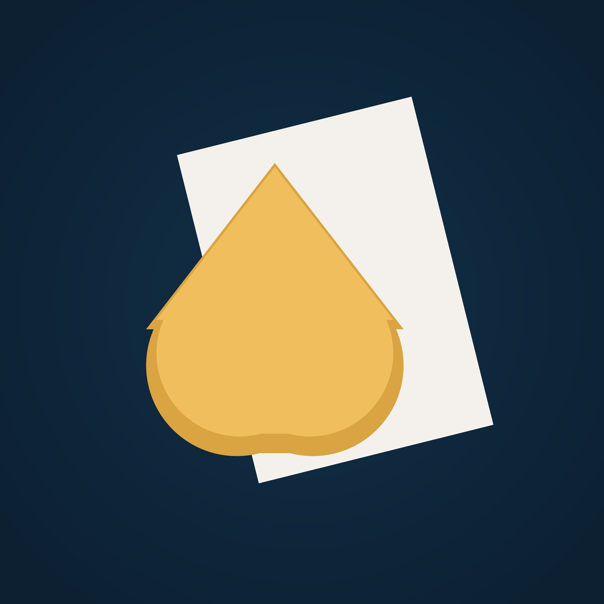
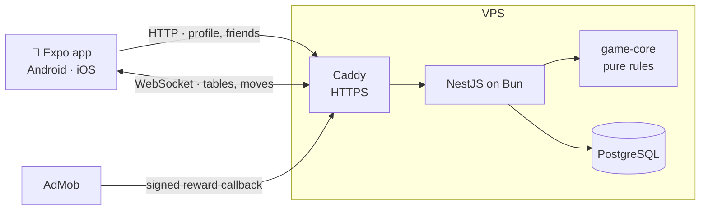

<div align="center">



# DurakMaster

**Online Durak for phones** — throw-in and transfer, 2–6 players, 24/36/52-card decks, jokers.

[](https://github.com/Zilero232/DurakMaster/actions/workflows/verify.yml)


</div>

---

## Features

- 🃏 **Two variants** — throw-in and transfer Durak, with draws on or off, jokers and "with cheats" tables
- 👥 **2–6 players** — public tables or private ones behind a password, bots to fill empty seats
- 🤝 **Friends** — add friends, see who is online, invite them straight to your table
- 🏆 **Progress** — rating and leagues, achievements, a daily bonus, rewarded ads to skip the wait
- 🎨 **Feel** — card themes, sounds and haptics on every move, Russian and English
- 🔒 **Fair by design** — the server shuffles with `crypto.randomInt`, validates every move and never sends the deck order or other hands to a phone

## Stack

| Layer       | Technology                                                                    |
| ----------- | ----------------------------------------------------------------------------- |
| Client      | Expo SDK 57, React Native 0.86, Expo Router, TanStack Query, Zustand, i18next |
| Table       | Native views + Reanimated — no canvas                                         |
| Realtime    | `partysocket` ↔ `ws` + `@nestjs/platform-ws`                                  |
| API         | NestJS 12 on Bun, Prisma 7, PostgreSQL, better-auth                           |
| Game rules  | `packages/game-core` — pure functions, no transport, no database              |
| Table state | In server memory; results and balances go to Postgres                         |



**The table is not a canvas.** Cards are a few dozen plain views animated by Reanimated on the UI
thread. A canvas would need its own layout system, its own fonts and manual hit testing.

**Cards are drawn in code.** A card is assembled from views and a deck theme is a set of colours —
no deck assets, and a card stays sharp at any density.

**`ui-kit/` is a terminal layer.** Every layer imports it, it imports none of them: the deck theme
and press feedback arrive through contexts the app fills in.

## Quick start

```bash
mise install                                  # bun and node, pinned in mise.toml
bun install
cp .env.example .env                          # fill in BETTER_AUTH_SECRET
bun dev:infra                                 # Postgres in Docker
bun --filter @durak-master/server db:migrate  # database schema

bun dev:server                                # API — one terminal
bun dev:mobile                                # Expo — another, the QR code lives here
```

Press `a` for the Android emulator, or scan the QR code with a dev build on your phone.

> [!TIP]
> Run the two dev servers in separate terminals: `bun --filter --parallel` prefixes every line with
> the package name and mangles the QR code Expo draws.

In a debug build the API address is derived from the host serving the bundle. To pin it, set
`EXPO_PUBLIC_API_URL`.

## Commands

| Command        | What it does                                       |
| -------------- | -------------------------------------------------- |
| `bun verify`   | Typecheck, tests, ESLint, Steiger, Prettier — CI   |
| `bun fix`      | ESLint `--fix` and Prettier `--write`              |
| `bun test`     | Unit and rule tests                                |
| `bun android`  | Build and run on an emulator or a connected device |
| `bun ios`      | Build and run on the iOS simulator                 |
| `bun prebuild` | Generate the native `android/` and `ios/` projects |

## Structure

```text
apps/
├── mobile/      Expo client — app/ routes, ui-kit/ design system, FSD layers at the root
└── server/      NestJS API, WebSocket gateway, game rooms
packages/
├── schemas/     Zod schemas shared by client and server
└── game-core/   Durak rules — pure, testable without a network
infra/           Caddy config for the VPS, icon generator
docs/
├── games/       game rules — the source of truth for game-core
├── store/       Google Play release: listing, privacy, checklist
├── fsd.md       client architecture
└── style.md     code style
```

## Testing

| Level | Where                              | What it covers                                    |
| ----- | ---------------------------------- | ------------------------------------------------- |
| Rules | `packages/game-core/**/_tests`     | Beating, throw-ins, transfers, jokers, exit order |
| Rules | `durak/_tests/rule-matrix.test.ts` | Every mode × deck × player count                  |
| Unit  | `apps/*/**/_tests`                 | Stakes and refunds, room lifecycle, socket, ads   |

Game rules are where bugs cost the most — read [docs/games/durak.md](docs/games/durak.md) before
touching `game-core`. Its checklist of typical mistakes is what the rule tests are built from.

## Shipping

| Target  | How                                                                       |
| ------- | ------------------------------------------------------------------------- |
| API     | [DEPLOY.md](DEPLOY.md) — image to ghcr, a VPS behind Caddy, manual deploy |
| Android | [docs/store/](docs/store/README.md) — EAS build, Google Play              |
| iOS     | Planned — EAS already builds it, the App Store profile comes later        |

## Documentation

- [Game rules](docs/games/) — read before editing `game-core`
- [FSD](docs/fsd.md) — client architecture
- [Code style](docs/style.md)
- [CLAUDE.md](CLAUDE.md) — project invariants
- [CONTRIBUTING.md](CONTRIBUTING.md) — how to work in this repository
- [SECURITY.md](SECURITY.md) — reporting a vulnerability

Table sounds are a [Kenney](https://kenney.nl) set (CC0) in `apps/mobile/assets/sounds`.

## License

Proprietary — all rights reserved. See [LICENSE](LICENSE).
